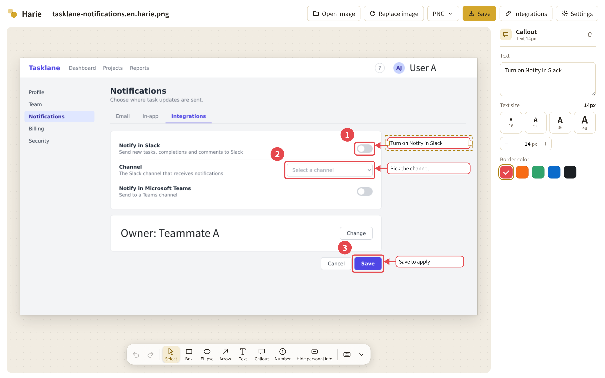
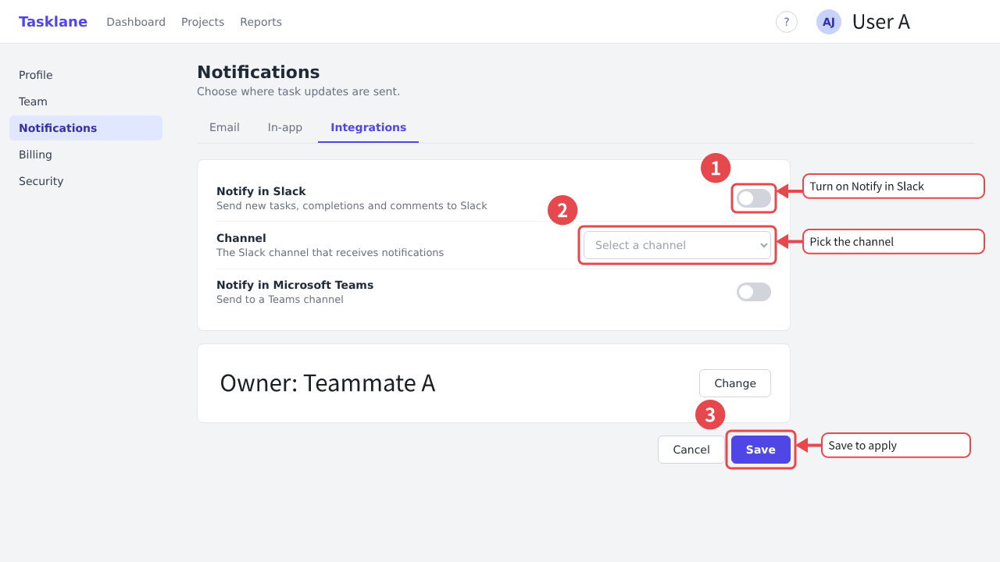

<p align="center">
  
</p>

<h1 align="center">Harie</h1>

<p align="center"><b>Just an image. Editable anytime.</b></p>

<p align="center">English | <a href="README.md">日本語</a></p>

<p align="center">
  <a href="https://hosshan.github.io/harie/en/">Website</a> ·
  <a href="https://hosshan.github.io/harie/app/">Open the web editor</a> ·
  <a href="https://www.npmjs.com/package/@harie/mcp">MCP server</a>
</p>

An app for adding boxes, arrows and captions to screenshots, for example when writing user guides for web services. Saved files display as ordinary JPEG / PNG images, and opening one in Harie lets you edit the annotations again and again.



A saved file works as a normal image as is. The image below was saved with Harie too: download it and open it in the [web editor](https://hosshan.github.io/harie/app/) to select and edit its annotations.

<p align="center">
  
</p>

- Documentation: [docs/](docs/README.md) (in Japanese)
- Design decisions: [docs/adr/](docs/adr/README.md) (in Japanese)
- For AI agents: [CLAUDE.md](CLAUDE.md)

```sh
pnpm install
pnpm check                      # lint + typecheck + test
pnpm --filter @harie/web dev    # web editor (http://localhost:5173/)
```

The MVP (M0–M5: web editor, Chrome extension, MCP server, AI suggestions and personal-data masking) is implemented. See [local setup](docs/05-development/local-setup.md) for running it locally and the [implementation plan](docs/04-plan/implementation-plan.md) for what comes next (both in Japanese).

The editor UI is available in English and Japanese.

## Apps

Usage, installation, local checks and release steps are in each app's README. These READMEs are in Japanese, except the MCP server's.

| App | Description |
|---|---|
| [apps/web](apps/web/README.md) | Web editor (PWA). Open an image, annotate it and save |
| [apps/extension](apps/extension/README.md) | Chrome extension. Capture the current page and annotate it right away |
| [apps/mcp](apps/mcp/README.md) | MCP server (`@harie/mcp` on npm). Read and write annotations from Claude and other clients |
| [apps/cli](apps/cli/README.md) | Development CLI (`pnpm harie`). Inspect, create and re-render files |
| [apps/desktop](apps/desktop/README.md) | Desktop app (Tauri 2, macOS / Windows). Open with the OS dialog and save in place |
| [apps/site](apps/site/README.md) | Landing page (GitHub Pages). The web editor is published alongside it at `/app/` |

## Packages

| Package | Description |
|---|---|
| [packages/model](packages/model/README.md) | Schema and operations for annotation documents |
| [packages/format](packages/format/README.md) | Embedding into and reading from JPEG / PNG |
| [packages/render](packages/render/README.md) | Rendering annotations → SVG → pixels |
| [packages/ai](packages/ai/README.md) | AI annotation suggestions and personal-data detection |
| [packages/editor](packages/editor/README.md) | Editor UI (React) |

## License

MIT ([LICENSE](LICENSE)). The bundled font (Noto Sans JP) is under the SIL Open Font License 1.1.
