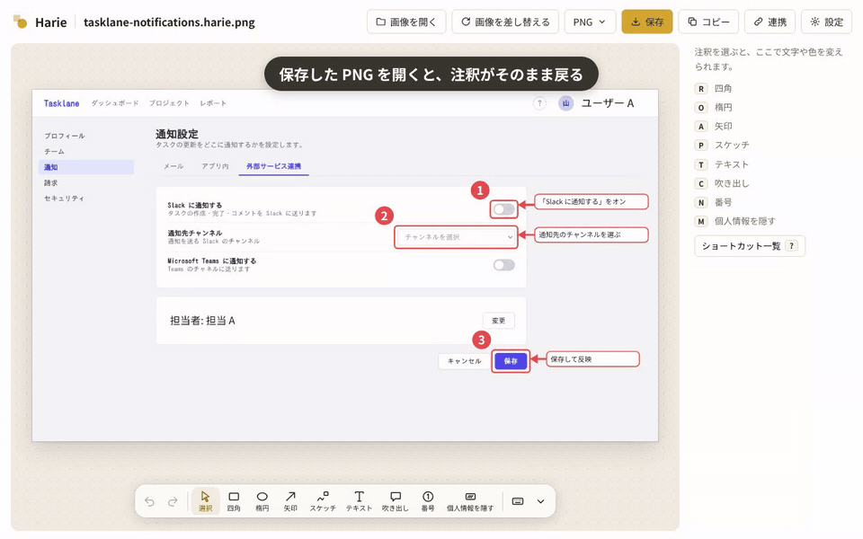
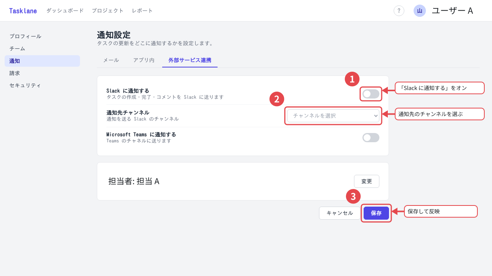

<p align="center">
  
</p>

<h1 align="center">Harie</h1>

<p align="center"><b>ただの画像なのに、何度でも直せる。</b></p>

<p align="center"><a href="README.en.md">English</a> | 日本語</p>

<p align="center">
  <a href="https://harie.studio/">サイト</a> ·
  <a href="https://harie.studio/app/">Web エディタを開く</a> ·
  <a href="https://chromewebstore.google.com/detail/harie/dgbghdgnmjcgjdmhfnmcdphkafkbefll">Chrome 拡張</a> ·
  <a href="https://www.npmjs.com/package/@harie/mcp">MCP サーバー</a>
</p>

Web サービス向けのガイド作成などで、スクリーンショットに枠・矢印・説明文を付けるアプリ。保存した画像は通常の JPEG / PNG として表示でき、Harie で開けば注釈を何度でも再編集できる。



保存したファイルはそのまま普通の画像として使える。下の画像も Harie で保存したもので、ダウンロードして [Web エディタ](https://harie.studio/app/)で開くと注釈を選んで直せる。

<p align="center">
  
</p>

- ドキュメント: [docs/](docs/README.md)
- 設計判断: [docs/adr/](docs/adr/README.md)
- AI エージェント向け: [CLAUDE.md](CLAUDE.md)

```sh
pnpm install
pnpm check                      # lint + typecheck + test
pnpm --filter @harie/web dev    # Web エディタ（http://localhost:5173/）
```

MVP（M0〜M5: Web エディタ・Chrome 拡張・MCP サーバー・AI 提案と個人情報の加工）を実装済み。手元で動かす手順は [ローカルでの起動と確認](docs/05-development/local-setup.md)、今後の計画は [実装計画](docs/04-plan/implementation-plan.md) を参照。

## アプリ

使い方・インストール・ローカルでの確認・リリースの手順は各アプリの README にある。

| アプリ | 内容 |
|---|---|
| [apps/web](apps/web/README.md) | Web エディタ（PWA）。画像を開いて注釈を付け、保存する |
| [apps/extension](apps/extension/README.md) | Chrome 拡張。表示中のページをキャプチャして、そのまま注釈を付ける |
| [apps/mcp](apps/mcp/README.md) | MCP サーバー（npm の `@harie/mcp`）。Claude などから注釈を読み書きする |
| [apps/cli](apps/cli/README.md) | 開発用 CLI（`pnpm harie`）。ファイルの中身の確認・作成・描き直し |
| [apps/desktop](apps/desktop/README.md) | デスクトップ版（Tauri 2、macOS / Windows）。OS のダイアログで開き、上書き保存する |
| [apps/site](apps/site/README.md) | LP（GitHub Pages）。Web エディタも `/app/` に一緒に公開する |

## パッケージ

| パッケージ | 内容 |
|---|---|
| [packages/model](packages/model/README.md) | 注釈ドキュメントのスキーマと操作 |
| [packages/format](packages/format/README.md) | JPEG / PNG への埋め込み・読み出し |
| [packages/render](packages/render/README.md) | 注釈 → SVG → ピクセルの描画 |
| [packages/ai](packages/ai/README.md) | AI の補足提案と個人情報の検出 |
| [packages/editor](packages/editor/README.md) | エディタ UI（React） |

## ライセンス

MIT（[LICENSE](LICENSE)）。同梱するフォント（Noto Sans JP）は SIL Open Font License 1.1。
