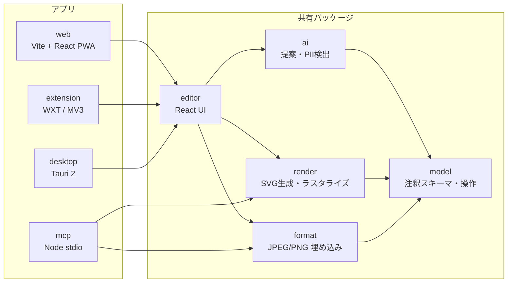
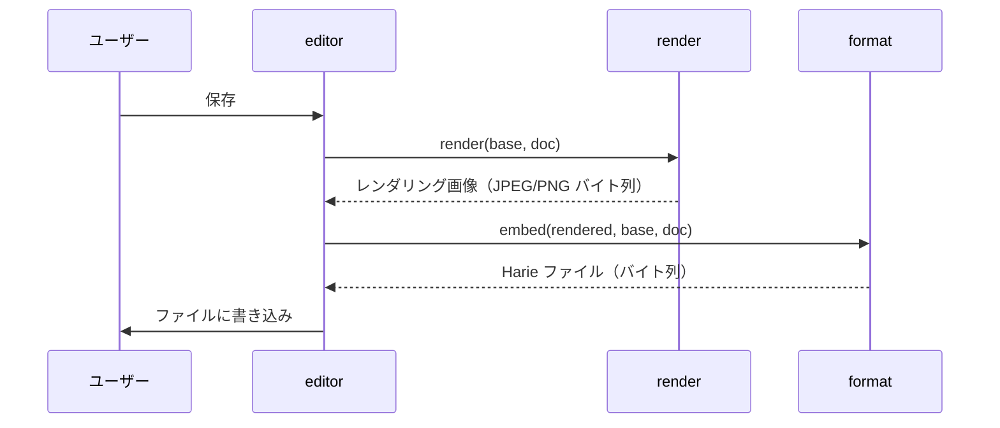

# アーキテクチャ

- ステータス: ドラフト
- 最終更新: 2026-10-07
- 関連 ADR: [0002 アプリ基盤](../adr/0002-app-platform.md) / [0003 モノレポ](../adr/0003-monorepo-tooling.md) / [0004 画像形式](../adr/0004-image-container-format.md) / [0005 描画](../adr/0005-rendering-pipeline.md) / [0007 PII](../adr/0007-pii-masking.md)

## 1. 設計方針

1. **ファイルが唯一の正。** サーバーなしで全データを復元できる。クラウドは後から足す「控え」であり、正ではない（NFR-DATA-04）。
2. **コアは 1 回だけ書く。** 形式の読み書き・注釈モデル・描画は UI 非依存の TypeScript（+WASM）パッケージにし、Web / 拡張 / デスクトップ / MCP で共有する。
3. **描画は 1 系統。** 「注釈ドキュメント → SVG → ラスタライズ」を全環境で同じコードで行い、どこで保存しても同じピクセルになる（NFR-PLAT-05）。
4. **AI は提案するだけ。** AI の出力は注釈ドキュメントへの「提案パッチ」であり、適用はユーザー（または MCP クライアント）が決める。

## 2. 全体構成

| パッケージ | 責務 | 実行環境 |
|---|---|---|
| `packages/model` | 注釈ドキュメントのスキーマ（zod）、バリデーション、操作（追加・更新・削除・番号振り直し）、マイグレーション | ブラウザ / Node |
| `packages/format` | JPEG / PNG への埋め込みと読み出し、整合性チェック | ブラウザ / Node |
| `packages/render` | 注釈 → SVG、SVG → ピクセル（resvg-wasm）、ベース画像との合成、JPEG/PNG エンコード、マスク適用 | ブラウザ / Node |
| `packages/ai` | 補足提案・PII 検出のプロンプトと結果の正規化。LLM 呼び出しは注入（プロバイダ非依存） | ブラウザ / Node |
| `packages/editor` | エディタ UI（React）。キャンバス操作、提案レビュー、保存 | ブラウザ |
| `apps/web` | Web アプリ（PWA）。File System Access API で上書き保存 | ブラウザ |
| `apps/extension` | Chrome 拡張。キャプチャ・DOM 情報取得、拡張ページでエディタを開く | Chrome |
| `apps/desktop` | Tauri 2 の殻。ファイル関連付け、ネイティブ保存 | macOS / Windows |
| `apps/mcp` | MCP サーバー。ファイルを開いて注釈を変更し、再レンダリングして保存 | Node |
| `apps/cli` | 開発用 CLI（`pnpm harie`）。ファイルの検査・作成・描き直し・PII 加工。WASM とフォントを Node で読み込む | Node |

依存の向きは `apps → editor/ai → render/format → model` の一方向。`model` / `format` / `render` は DOM・React に依存しない（Lint で禁止する）。

## 3. 主要フロー

### 3.1 保存

- ベース画像は**読み込んだときのバイト列をそのまま**持ち回り、再エンコードしない（FR-FILE-04）。
- 再エンコードされるのはレンダリング画像だけで、毎回ベース画像から作り直すので世代劣化しない。

### 3.2 読み込み

1. `format.read(bytes)` で XMP 記述子と JUMBF ペイロードを探す。
2. 無い → 通常画像として新規ドキュメント（ベース画像 = そのファイル）。
3. ある → ハッシュを検証。
   - 一致 → ドキュメントとベース画像を復元。
   - 不一致 → 「外部で編集された可能性」を表示し、ユーザーが選ぶ（埋め込みから復元 / 現在のピクセルを新しいベースとして開く）。
4. `model.migrate(doc)` で古いスキーマを最新に上げる（FR-FILE-07）。

### 3.3 AI 補足提案

1. 入力: ベース画像、（あれば）DOM スナップショット、ユーザーの意図（「〇〇の設定方法を説明したい」）、既存注釈。
2. `ai.suggest()` が LLM（画像入力対応モデル）に構造化出力で問い合わせる。
3. 返ってきた候補の座標を、DOM スナップショットの要素矩形にスナップする（FR-AI-03）。
4. 候補は `status: "suggested"` の注釈としてエディタに下書き表示。採用で `status` を外す。

### 3.4 PII 加工

1. 検出: DOM テキストがあれば正規表現・辞書・LLM で分類し、要素矩形を得る。無ければ画像を LLM に渡して領域と種別を得る。
2. ユーザーが候補を確認し、加工方法（ダミー置換 / ぼかし / モザイク / 塗りつぶし）を選ぶ。
3. `renderer.applyMasks()`（`packages/render`）で**ベース画像そのものを書き換える**。返ってきた記録は `recordPiiApplied()`（`packages/model`）で `pii.applied` に追記する。
4. 書き換えたベース画像は新しいバイト列になり、以後これが下地になる。加工前のベース画像はメモリからも破棄する（[ADR-0007](../adr/0007-pii-masking.md)）。

`applyMasks` の方式（不可逆性の根拠）:

- ベース画像をいったんラスタライズし、範囲の上に**元のピクセルに依存しない不透明な図形**を重ねた SVG を作って、resvg で描き直す（描画は 1 系統のまま。ADR-0005）。
- 範囲は整数ピクセルの外側に広げ、縁のアンチエイリアスを切る（`crispEdges`）。範囲内に元の色が混ざらない。
- 重ねる図形の色の材料は次だけ。範囲内の細部は使わない。

| 方法 | 材料 | 強度 |
|---|---|---|
| 塗りつぶし（`fill`） | 指定色（既定 `#1C2024`） | 元の情報なし |
| ダミー置換（`replace`） | 範囲のすぐ外側 2px の最頻色（背景色）＋ダミー文字 | 元の情報なし |
| モザイク（`mosaic`） | ブロックごとの平均色 | ブロックは最小 16px、範囲の短辺の 1/8 以上 |
| ぼかし（`blur`） | モザイクと同じブロック平均を、さらにぼかしたもの | ブロックは最小 16px、範囲の短辺の 1/4 以上 |

- ぼかしは一般的なガウスぼかしではなく「ブロック平均のぼかし」にしている。ガウスぼかしは逆畳み込みで部分的に戻せるが、ブロック平均より細かい情報はそもそも結果に含まれない。
- 小さな文字のモザイクは、フォントが既知なら推定される恐れがある（depixelation）。文字には塗りつぶしかダミー置換を既定にする（ADR-0007）。
- 出力は元と同じ形式（JPEG は品質 92 で再エンコード、PNG は可逆）。背景は白で合成するため、透過 PNG は不透明になる。
- テスト（`packages/render/src/mask.test.ts`）で、範囲内の元の内容を変えても結果が変わらないこと、保存したファイルに加工前のバイト列と元の文字が含まれないことを確かめている（NFR-SEC-02）。

## 4. AI 呼び出し

| 場面 | LLM の所在 | 方針 |
|---|---|---|
| Web / 拡張 / デスクトップの提案・PII 検出 | Harie が呼ぶ | MVP は BYOK（ユーザーの API キーをローカル保存）。本番は薄い API プロキシ（キー秘匿・利用量管理）を用意 |
| MCP 経由 | MCP クライアント側の LLM | MCP サーバーは LLM を呼ばない。画像と注釈を返し、変更を受け付けるだけ。提案はクライアント側の LLM が行う |

- 既定モデルは画像入力に対応した Claude の最新モデル。`packages/ai` はプロバイダ非依存のインターフェースにして、テストではモックを注入する。
- 画像を外部送信する前に、送信することを UI に明示する（NFR-SEC-01）。

## 5. 保存先とファイル I/O

| 環境 | 開く | 保存 |
|---|---|---|
| Web（Chrome/Edge） | File System Access API / D&D / クリップボード | 同じファイルへ上書き可能 |
| Web（Safari/Firefox） | `<input type=file>` / D&D | ダウンロード（上書き不可） |
| Chrome 拡張 | キャプチャ結果 / ファイル | `chrome.downloads` |
| デスクトップ | OS のファイルダイアログ、ファイル関連付け | 直接上書き |
| MCP | パス指定 | パス指定（上書き前にバックアップを任意で作成） |

## 6. 横断的関心事

- **スキーマのバージョニング**: 注釈ドキュメントは `schemaVersion` を持ち、`model` にマイグレーションを集約する。新しいフィールドは「知らなければ無視」できる形で追加する。
- **フォント**: 描画の一致のため、フォントはシステムフォントを使わず同梱する（Noto Sans JP のサブセット等）。ドキュメントにはフォント ID のみ記録する。
- **エラー**: 読み込み失敗時は必ず「通常の画像として開く」にフォールバックする（NFR-DATA-03）。
- **テレメトリ**: MVP では送らない。入れる場合は ADR を書く。
