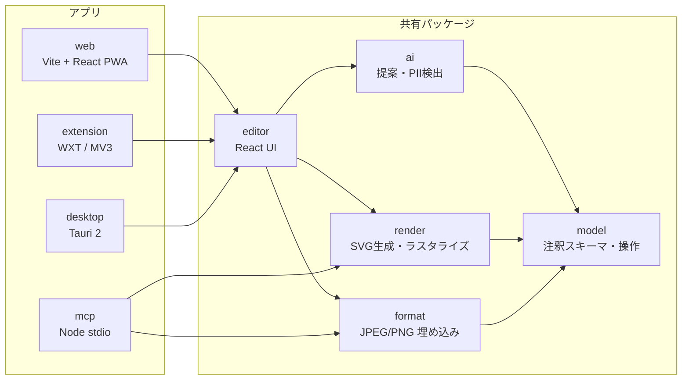
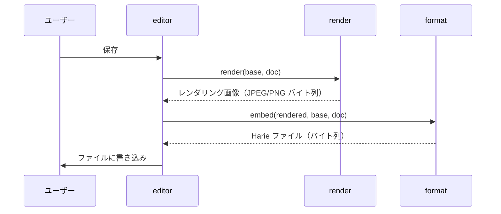

# アーキテクチャ

- ステータス: ドラフト
- 最終更新: 2026-10-19
- 関連 ADR: [0002 アプリ基盤](../adr/0002-app-platform.md) / [0003 モノレポ](../adr/0003-monorepo-tooling.md) / [0004 画像形式](../adr/0004-image-container-format.md) / [0005 描画](../adr/0005-rendering-pipeline.md) / [0007 PII](../adr/0007-pii-masking.md)

## 1. 設計方針

1. **ファイルが唯一の正。** サーバーなしで全データを復元できる。クラウドは後から足す「控え」であり、正ではない（NFR-DATA-04）。
2. **コアは 1 回だけ書く。** 形式の読み書き・注釈モデル・描画は UI 非依存の TypeScript（+WASM）パッケージにし、Web / 拡張 / デスクトップ / MCP で共有する。
3. **描画は 1 系統。** 「注釈ドキュメント → SVG → ラスタライズ」を全環境で同じコードで行い、どこで保存しても同じピクセルになる（NFR-PLAT-05）。
4. **AI は提案するだけ。** AI の出力は注釈ドキュメントへの「提案パッチ」であり、適用はユーザー（または MCP クライアント）が決める。

## 2. 全体構成

| パッケージ | 責務 | 実行環境 |
|---|---|---|
| `packages/model` | 注釈ドキュメントのスキーマ（zod）、バリデーション、操作（追加・更新・削除・番号振り直し）、マイグレーション | ブラウザ / Node |
| `packages/format` | JPEG / PNG への埋め込みと読み出し、整合性チェック | ブラウザ / Node |
| `packages/render` | 注釈 → SVG、SVG → ピクセル（resvg-wasm）、ベース画像との合成、JPEG/PNG エンコード、マスク適用 | ブラウザ / Node |
| `packages/ai` | 補足提案・PII 検出のプロンプトと結果の正規化。LLM 呼び出しは注入（プロバイダ非依存） | ブラウザ / Node |
| `packages/editor` | エディタ UI（React）。キャンバス操作、提案レビュー、保存 | ブラウザ |
| `apps/web` | Web アプリ（PWA）。File System Access API で上書き保存 | ブラウザ |
| `apps/extension` | Chrome 拡張。キャプチャ・DOM 情報取得、拡張ページでエディタを開く | Chrome |
| `apps/desktop` | Tauri 2 の殻。ファイル関連付け、ネイティブ保存 | macOS / Windows |
| `apps/mcp` | MCP サーバー。ファイルを開いて注釈を変更し、再レンダリングして保存 | Node |
| `apps/cli` | 開発用 CLI（`pnpm harie`）。ファイルの検査・作成・描き直し・PII 加工。WASM とフォントを Node で読み込む | Node |

依存の向きは `apps → editor/ai → render/format → model` の一方向。`model` / `format` / `render` は DOM・React に依存しない（Lint で禁止する）。

## 3. 主要フロー

### 3.1 保存

- ベース画像は**読み込んだときのバイト列をそのまま**持ち回り、再エンコードしない（FR-FILE-04）。
- 再エンコードされるのはレンダリング画像だけで、毎回ベース画像から作り直すので世代劣化しない。

### 3.2 読み込み

1. `format.read(bytes)` で XMP 記述子と JUMBF ペイロードを探す。
2. 無い → 通常画像として新規ドキュメント（ベース画像 = そのファイル）。
3. ある → ハッシュを検証。
   - 一致 → ドキュメントとベース画像を復元。
   - 不一致 → 「外部で編集された可能性」を表示し、ユーザーが選ぶ（埋め込みから復元 / 現在のピクセルを新しいベースとして開く）。
4. `model.migrate(doc)` で古いスキーマを最新に上げる（FR-FILE-07）。

### 3.3 AI 補足提案

1. 入力: ベース画像、（あれば）DOM スナップショット、ユーザーの意図（「〇〇の設定方法を説明したい」）、既存注釈。
2. `ai.suggest()` が LLM（画像入力対応モデル）に構造化出力で問い合わせる。
3. 返ってきた候補の座標を、DOM スナップショットの要素矩形にスナップする（FR-AI-03）。
4. 候補は `status: "suggested"` の注釈としてエディタに下書き表示。採用で `status` を外す。

### 3.4 PII 加工

1. 検出: DOM テキストがあれば正規表現・辞書・LLM で分類し、要素矩形を得る。無ければ画像を LLM に渡して領域と種別を得る。
2. ユーザーが候補を確認し、加工方法（ダミー置換 / ぼかし / モザイク / 塗りつぶし）を選ぶ。
3. `renderer.applyMasks()`（`packages/render`）で**ベース画像そのものを書き換える**。返ってきた記録は `recordPiiApplied()`（`packages/model`）で `pii.applied` に追記する。
4. 書き換えたベース画像は新しいバイト列になり、以後これが下地になる。加工前のベース画像はメモリからも破棄する（[ADR-0007](../adr/0007-pii-masking.md)）。

`applyMasks` の方式（不可逆性の根拠）:

- ベース画像をいったんラスタライズし、範囲の上に**元のピクセルに依存しない不透明な図形**を重ねた SVG を作って、resvg で描き直す（描画は 1 系統のまま。ADR-0005）。
- 範囲は整数ピクセルの外側に広げ、縁のアンチエイリアスを切る（`crispEdges`）。範囲内に元の色が混ざらない。
- 重ねる図形の色の材料は次だけ。範囲内の細部は使わない。

| 方法 | 材料 | 強度 |
|---|---|---|
| 塗りつぶし（`fill`） | 指定色（既定 `#1C2024`） | 元の情報なし |
| ダミー置換（`replace`） | 範囲のすぐ外側 2px の最頻色（背景色）＋ダミー文字 | 元の情報なし |
| モザイク（`mosaic`） | ブロックごとの平均色 | ブロックは最小 16px、範囲の短辺の 1/8 以上 |
| ぼかし（`blur`） | モザイクと同じブロック平均を、さらにぼかしたもの | ブロックは最小 16px、範囲の短辺の 1/4 以上 |

- ぼかしは一般的なガウスぼかしではなく「ブロック平均のぼかし」にしている。ガウスぼかしは逆畳み込みで部分的に戻せるが、ブロック平均より細かい情報はそもそも結果に含まれない。
- 小さな文字のモザイクは、フォントが既知なら推定される恐れがある（depixelation）。文字には塗りつぶしかダミー置換を既定にする（ADR-0007）。
- 出力は元と同じ形式（JPEG は品質 92 で再エンコード、PNG は可逆）。背景は白で合成するため、透過 PNG は不透明になる。
- テスト（`packages/render/src/mask.test.ts`）で、範囲内の元の内容を変えても結果が変わらないこと、保存したファイルに加工前のバイト列と元の文字が含まれないことを確かめている（NFR-SEC-02）。

### 3.5 ベース画像の差し替え（FR-EDIT-10）

画面が変わったときに、注釈を残したまま画像だけを新しいキャプチャにする（要求分析 S2）。

1. 新しい画像を `readBaseImage()`（`packages/format`）で読む。普通の JPEG / PNG はバイト列をそのまま、Harie ファイルなら埋め込みのベース画像を使う（古い注釈を焼き込んだ画像を下地にしない）。再エンコードはしない（ADR-0004）。
2. `rebaseDocument()`（`packages/render`）で注釈を新しい画像に合わせる。大きさが同じなら注釈はそのまま。違えば位置と大きさを縦横それぞれの比率で、線の太さ・文字の大きさ・角丸は小さい方の比率で拡大縮小する。省略していた線の太さ・文字の大きさはテーマの既定値を書き込んでから拡大縮小し、見た目の比率を保つ。紐付けた番号は拡大縮小した枠から置き直す（ADR-0011）。
3. `pii.applied` は元の画像の加工の記録なので外す。新しい画像にはマスクがかかっていないため、元の範囲（新しい座標に直したもの）を返し、エディタはマスクの下書きに、MCP は `previousPii` として返す。かけ直すかは利用者が決める（ADR-0007）。
4. `docId` はそのまま（同じガイド画像の更新）。保存すると `revision` が進む。

画面の内容が変わって位置が合わない注釈は、差し替えた後に利用者（または MCP クライアントの LLM）が直す。自動で要素を追いかけることはしない。

## 4. AI 呼び出し

| 場面 | LLM の所在 | 方針 |
|---|---|---|
| Web / 拡張 / デスクトップの提案・PII 検出 | Harie が呼ぶ | BYOK（ユーザーの API キーをローカル保存）。Anthropic のキーを貼るか、OpenRouter の OAuth（PKCE）で接続する（[ADR-0012](../adr/0012-openrouter-oauth.md)）。Harie が費用を持つプロキシは置かない（利用者が増えたら別の ADR で再検討） |
| MCP 経由 | MCP クライアント側の LLM | MCP サーバーは LLM を呼ばない。画像と注釈を返し、変更を受け付けるだけ。提案はクライアント側の LLM が行う |

- 既定モデルは画像入力に対応した Claude の最新モデル（`claude-opus-5-5`）。`packages/ai` はプロバイダ非依存のインターフェース（`LlmClient`）にして、テストではモックを注入する。
- 画像を外部送信する前に、送信することを UI に明示する（NFR-SEC-01）。Web では送信先の表示と「この画像を送信してよい」の同意がないとボタンを押せない。
- 出力は構造化出力（JSON スキーマ）で受け、zod で検証してから使う。断られた（`refusal`）・途中で切れた・形が違う応答は理由付きのエラーにする。
- 画像は長辺 1568px 以下に縮めて送り、返ってきた座標を元の画像の座標に戻す。
- 提案 1 件は「強調枠（rect）＋説明の吹き出し（callout）」の 2 つの注釈。吹き出しは枠の右 → 左 → 下 → 上の順で画像に収まる側に置く（`placeCallout()`。番号と吹き出しをまとめて付ける操作と共有）。DOM があれば要素番号か重なり（IoU 0.3 以上）で枠を要素の矩形に合わせる（FR-AI-03）。
- PII の候補は DOM のテキスト（正規表現・入力欄の手がかり）と画像の検出を合わせ、重なりは DOM を優先して 1 つにする。加工方法の既定は文字ならダミー置換（種類と形を保つ値。`example.com` など予約済みの値を使う）、顔は塗りつぶし。候補はエディタのマスクの下書きになり、利用者が確認してから適用する。読み取った元の文字列はメモリ上でだけ使い、保存しない。
- API キーはブラウザの localStorage にだけ置く。ファイル・ログ・エラー文に含めない（NFR-SEC-04）。
- OpenRouter の接続（FR-AI-05、ADR-0012）: 設定の「OpenRouter で接続」で別のウィンドウに OpenRouter の許可の画面（`code_challenge` は S256）を開き、今のページに `code` 付きで戻す。戻ったウィンドウが `code_verifier`（接続の間だけ localStorage に置く）と合わせてキーに換えて登録し、自分を閉じる。元のウィンドウは `storage` イベントで接続を受け取るので、編集中の画像はそのまま。戻り先に https のページが要るので Web 版だけで出し、Chrome 拡張とデスクトップでは出さない。呼び出しは `createOpenRouterClient` で、モデルは最新の Claude Opus の別名を使う。
- API キーがなくても使える部分は使えるようにする。DOM があれば、DOM のテキストだけで個人情報の候補を出す（`detectPiiFromDom()`。画像は送らないので同意は求めない。FR-PII-06）。AI への接続はヘッダーの「設定」で行い、設定では Anthropic Console のキー作成画面へのリンクと手順を示す。
- 普段の画面に AI の操作を足さない。説明の提案は、AI に接続しているときだけパレットの道具の後ろに「AI提案」（きらめきのアイコン。`Editor` の `paletteActions`）を出し、押すとダイアログで説明したいことなどを聞き、送信先の表示と同意を経て送る（`useAiSuggest`）。ダイアログで聞く項目は `apps/web/src/ai/suggest-context.ts` の一覧から作り、項目を足すと入力欄が増え、説明したいこと以外は項目名付きの補足（`SuggestInput.context`）として AI に送る。提案が残っている間だけ、右の欄の末尾にまとめて採用・却下する欄を出す。個人情報を探す操作（DOM のテキストから探す・AI で画像から探す。`AiPiiPanel`）は、個人情報を隠す道具を選んでいる・マスクの範囲があるときだけ、マスクの欄の末尾に出す。
- 評価: `packages/ai/eval` の合成画面（架空の値の個人情報と正解の範囲を持つ）で、PII の再現率・適合率と、提案が狙いの要素を指す割合を測る。認証は API キーか、Claude のプランの `CLAUDE_CODE_OAUTH_TOKEN`（Claude Agent SDK 経由。評価専用）。実際に Claude を呼ぶため CI では動かさない。手順は `packages/ai/CLAUDE.md`。

## 5. 保存先とファイル I/O

| 環境 | 開く | 保存 |
|---|---|---|
| Web（Chrome/Edge） | File System Access API / D&D / クリップボード | 同じファイルへ上書き可能 |
| Web（Safari/Firefox） | `<input type=file>` / D&D | ダウンロード（上書き不可） |
| Chrome 拡張 | キャプチャ結果 / ファイル | `chrome.downloads` |
| デスクトップ | OS のファイルダイアログ / D&D / クリップボード / ファイル関連付け（「このアプリで開く」） | Harie ファイルは直接上書き |
| MCP | パス指定 | パス指定（上書き前にバックアップを任意で作成） |

Web エディタ（`apps/web`）の保存の決まり:

- Harie ファイルを開いていた場合は、開いたファイルに上書きする（ハンドルがなければダウンロード）。
- 普通の画像を開いていた場合は元の画像を残し、`名前.harie.jpg` / `名前.harie.png`（ADR-0006）として別に保存する。
- 保存形式（JPEG / PNG）は「保存」の左のメニューで選べる。既定は開いたファイルの形式（Chrome 拡張のキャプチャは PNG）。形式を変えても、埋め込むベース画像は読み込んだバイト列のまま（ADR-0004）で、描いた画像だけが選んだ形式になる。そのため保存形式とベース画像の形式は一致しないことがある。形式を変えると拡張子が変わるので、Harie ファイルを開いていても上書きせず、別のファイルとして保存する。保存ダイアログには保存する形式の種類だけを渡し、ダイアログの既定の拡張子をその形式に合わせる。
- 「保存」の右の「コピー」（⌘⇧C）は、今の注釈を描いた画像を PNG でクリップボードに入れる（FR-FILE-11、`apps/web/src/copy.ts`）。描画は保存と同じ `packages/render`。クリップボードの画像はブラウザが PNG に描き直して載せるため、注釈データやベース画像は載らない（注釈を直せる形で渡すには保存する）。Safari（macOS のデスクトップ版）は押した直後に書き込みを始めないと断るので、描画を待たずに Promise のまま `ClipboardItem` に渡す。Async Clipboard API がない環境ではボタンを出さない。
- 編集画面の表示は保存と同じ `buildSvg` の SVG をブラウザで描き、その上に操作用の SVG（選択枠・ハンドル）を重ねる。保存時は `packages/render` の resvg-wasm で描くため、ブラウザと Node の保存結果はバイト単位で一致する（NFR-PLAT-05、`apps/web/e2e` で確認）。
- 文字はブラウザにも Noto Sans JP を読み込んで表示し、保存結果との見た目の差を小さくする。
- 外部で編集されたファイル（`RenderedImageModified`）は、既定で保存されていた注釈とベース画像で開き、「今の画像を新しい下地にする」も選べるようにする（3.2）。
- ヘッダーの「画像を差し替える」で、注釈を残したまま画像だけを選んだ画像にする（3.5）。開いているファイルはそのままなので、Harie ファイルなら保存で上書きする。差し替えは元に戻す／やり直すの対象にせず、履歴は差し替えた時点から始める（注釈の座標が前の画像のものに戻らないように）。保存前に適用したマスクの加工前の画像と、キャプチャ時の DOM 情報（拡張）は前の画像のものなので捨てる。
- 個人情報のマスクは、範囲を「適用前の下書き」としてエディタだけが持ち（注釈にはしない）、適用したときに `applyMasks` でベース画像を書き換える（3.4）。加工前の画像は保存するまでメモリにだけ持ち、その間は適用したマスクを選んで外せる（ADR-0009。残りのマスクを加工前の画像にかけ直す）。保存した時点でメモリからも捨てる。適用は元に戻す／やり直すの対象にはしない。元に戻せないので、適用はもう一度確かめてから行う。適用前の下書きは、注釈と同じ履歴（`EditorState.masks`。履歴の 1 コマはドキュメントと下書きの組）に入れ、範囲を足す・隠し方を変える・消す・キャンセルを元に戻せる。置き換える文字は入力欄を離れたときに 1 回の操作として確定する。適用したら、使い終わった下書きは履歴からも消す（元に戻しても下書きは戻らない）。隠し方は、右の欄のほかの項目と同じく見本付きのタイルで選ぶ。範囲を選んでいる間は注釈の選択を外し（右の欄の削除・Delete キーで注釈を消さない）、「キャンセル」で下書きを捨てて選択の道具に戻れる。
- PWA として、アプリ本体・描画エンジン（WASM）・フォントを最初の訪問で Service Worker にキャッシュする（約 14MB、うちフォントが約 11MB）。以後はオフラインでも開いて保存できる（NFR-PLAT-01）。

デスクトップ（`apps/desktop`、Tauri 2）の保存の決まり:

- 画面は Web と同じ `Workspace`（`@harie/web`）を使い、ファイルの開き方と保存先だけを差し替える。描画も Web と同じ resvg-wasm（ADR-0005）。PWA にはしない。
- 開く: OS のダイアログ、ウィンドウへのドラッグ＆ドロップ（Tauri が受け取るのでパスが分かる）、貼り付け。貼り付けた画像はパスがないので、保存のときに保存先を選ぶ。
- 保存の決まりは Web と同じ。Harie ファイルを開いていて形式が同じなら、開いたファイルにダイアログなしで上書きする。普通の画像・形式を変えたとき・貼り付けた画像は、開いたファイルと同じフォルダーを既定にした保存ダイアログを出す（名前は ADR-0006 の規則）。ダイアログで拡張子を付けなかったら保存形式の拡張子を足す。
- ファイルの読み書きは Rust のコマンド（`read_image` / `write_image`）だけで行い、拡張子が JPEG / PNG のファイルに限る。fs プラグインは入れず、画面から任意のファイルを読み書きできないようにする。画像は JSON にせずバイト列のまま渡す。
- 上書きは同じフォルダーの一時ファイルに書いてから置き換える。書き込みの途中で失敗しても元のファイルは壊れない。
- ウィンドウの題名に開いているファイル名を出す。
- ファイル関連付け: JPEG / PNG を開けるアプリとして登録する。既定のアプリは奪わない（macOS は `LSHandlerRank` を `Alternate`。「このアプリで開く」に出る）。Harie ファイルは普通の JPEG / PNG なので（ADR-0006）、Harie 専用の拡張子は作らない。
- 関連付けから渡されたファイル: macOS は `RunEvent::Opened`、Windows / Linux は起動引数で受け取る。起動中に別のファイルを開いたとき（Windows / Linux は 2 つ目の起動になる）は、single-instance プラグインで今のウィンドウに渡して 2 つ目は終わる。ウィンドウは 1 つで、渡されたうちの最後の 1 つを開く。画面ができる前に届いたファイルは Rust 側で溜めておき、画面が受け取る。
- 保存していない変更があるときは、ウィンドウを閉じる前と、D&D・関連付けで別のファイルを開く前に OS のダイアログで確かめる（WebView の `beforeunload` は Tauri では確認を出さないため。「画像を開く」は Web と同じ画面の確認）。
- 後続（M6 の残り）: 署名・公証、自動更新、配布、CI でのデスクトップのビルド。

エディタ（`packages/editor`）の操作の決まり:

- ヘッダーは 1 段にし、左に「ロゴ | ファイル名」、右側にメニュー（画像を開く・保存形式・保存・コピー・連携・設定。いずれもアイコン + 文字のボタン）を置く。ボタンとメニューは shadcn/ui の Button / DropdownMenu で作り、高さを揃える（ADR-0010）。画像を開いているときの「画像を開く」は、今の画像を閉じる前に確認のダイアログを出す（保存していない変更があればそれも伝える）。AI の API キーはヘッダーの「設定」の「AI に関する設定」で登録・削除する（右の欄の AI は、提案と個人情報の検出だけを扱い、キーが未登録のときは出さない）。
- 画像は、画面の残りの高さいっぱいに広がる台（少し沈んだ色＋細かい点の地）の上に、周りに余白を取って縦横比を保ったまま置く。画像には細い線と影を付け、白っぽいスクリーンショットでも画像の端が分かるようにする。右の欄は台と同じ高さに収め、長くなったら欄の中で動かす（幅が狭い画面では台の下に回す）。
- 注釈の道具（選択・四角・矢印など）と元に戻す／やり直すは、画像を置く台の下端中央（台は画面の下端まで広がる）に浮かぶ白いすりガラス（半透明＋ぼかし）のパレットにまとめる。画像の大きさや縦横比に関係なく同じ場所に出し、台の下の余白に重ねて画像を隠さないようにする。ファイル操作（開く・保存）のボタンと置き場所・見た目を分け、どちらの操作か迷わないようにする。
- パレットは、編集面でドラッグして描く・動かす・大きさを変える間は隠す（クリックしただけでは隠さない）。文字の編集中は隠さない。右端のボタンで小さくたたみ、画像に重なる範囲を最小にできる。
- テキスト・吹き出しは、置いた直後とダブルクリックで、編集面の上の入力欄で文字を直せる。入力欄は描画と同じ位置に重ね、吹き出しでは枠全体を覆って文字を上下中央に置く。入力欄を離れる・Ctrl / ⌘ + Enter で確定（1 回の操作として元に戻せる）、Esc で取りやめる。空にして確定すると注釈を消す（FR-EDIT-03）。
- スケッチの道具（FR-EDIT-13、キー P）では、指・マウス・ペンでなぞった線を離したときに `packages/editor/src/sketch.ts` の `recognizeSketch` で図形を読み取り、既存の注釈（四角・楕円・矢印。線は `style.head: "none"` の矢印）として 1 回の操作で追加する。手描きの線そのものは注釈にしない（ドキュメントのスキーマは変えない）。始点と終点が近い閉じた線は、外接矩形の辺と内接する楕円のどちらに近いかで四角か楕円にし、囲んだ面積が外接矩形に比べて小さい（三角・ひし形など）ときは図形にしない。開いた線は、ほぼまっすぐなら線、まっすぐな軸のあとで先端の近くを折り返していれば矢印（先端は始点から最も遠い点）にする。どれにも当たらなければ何も追加せず、編集面の上端に案内を少しの間出す。なぞっている間は線を編集面の上の SVG にだけ描く。続けてなぞれるよう、描いたあとも道具はスケッチのままにする。スケッチの道具のまま、なぞらずにクリックすると、注釈の上ならその注釈を選び（Shift で選択に足す・外す）、何もない所なら選択を外す。選んでいる図形は、スケッチの道具のままでもつまみで大きさを変え、掴んで動かせる（選んでいない図形の上からは、なぞり始められる）。
- 番号の道具で枠（四角・楕円）の上をクリックすると、その枠に紐付けた番号を置く。番号は枠の左上の角の外側に描かれ、枠を動かすと付いてくる。番号だけをドラッグすると紐付けを外す（ADR-0011）。
- 番号・吹き出しが付いていない枠があると、右の欄に「番号と吹き出しを付ける」を出す（FR-EDIT-14）。何も選んでいなければすべての枠が対象で、欄の上に出す。枠を選んでいればその枠だけが対象で、選んだ注釈の設定とは別の提案だと分かるよう、区切り線の下で欄の下端に留める（設定が長くて欄の中で動かしても見えたまま。幅が狭く欄が台の下に回るときは設定の後ろに置く）。押すと `completeSteps()`（`packages/render`）が、足りない方だけを足す。付いているとみなすのは、その枠に紐付けた番号・吹き出しか、紐付けていないものが枠のすぐ近く（番号 40px・吹き出し 48px 以内）にあるとき。番号は今ある番号の最大の続きから、枠を描いた順（重なりの下から）に振り、枠に紐付ける。吹き出しは「説明文を入力」の文字で枠に紐付け、AI の提案と同じ右 → 左 → 下 → 上の順で、ほかの注釈や先に置いた吹き出しに重ならない側に置く。足した番号・吹き出しは選んだ状態になり、まとめて 1 回の操作として元に戻せる。
- 要素で囲む道具（FR-EDIT-15、キー E）は、DOM 情報のある画像（Chrome 拡張でキャプチャし、差し替えていないもの）でだけパレットとショートカットの一覧に出す。`apps/web` が DOM の要素を `PickableElement`（画像のピクセルの矩形・ロール・名前。名前は accessible name か文字を空白を詰めて 40 文字まで）に変えて `Editor` に渡す。カーソルの下の要素のうちいちばん内側（面積が最小）のものを破線で示し、クリックすると `elementStepOps()`（`packages/editor/src/element-pick.ts`）が、要素の矩形から 8 CSS px（画像のピクセルでは画像の解像度の倍率を掛けた値。拡張で撮った画像では devicePixelRatio なので、Retina なら 16px）離して画像に収めた四角と、`completeSteps()` と同じ置き方の番号・吹き出しを 1 回の操作で足す。吹き出しの文字はロールと名前から作る（入力欄なら「〇〇」に入力します、ボタン・リンク・タブ・チェックボックスなどなら「〇〇」を押します、それ以外は「〇〇」を確認します。名前がなければ「説明文を入力」）。足した四角を選んだ状態にし、続けて選べるよう道具はそのままにする。AI は使わず、何も送らない。
- 画像の解像度に合わせる（FR-EDIT-16）。`estimateImageScale()`（`packages/render/src/scale.ts`）が、画像の 1px が等倍の画面の何 px にあたるかを 0.5 刻み・1〜4 倍で求める。手がかりは、Chrome 拡張で撮った画像なら撮ったときの devicePixelRatio、次に画像に記録された dpi（PNG の pHYs・JPEG の JFIF。`readImageDpi()`、`packages/format`）が 144 以上なら ÷72（72・96 は多くのツールが既定で書くので使わない）、どちらもなければ長い辺 ÷ 1440 の切り捨て。倍率はドキュメントに持たず、新しく描く注釈の style に倍率を掛けた値を書き込むだけにする（保存済みの注釈・既存のファイルの見た目は変わらない）。倍率が 1 より大きいときは、未記録の初期値もテーマの既定（線 4・文字 24）に倍率を掛けて埋め、右の欄の太さ・文字サイズの候補も倍率を掛けた値で出す。選んだ値は倍率で割って記録する（`harie.drawDefaults` は等倍の画面での値。別の解像度の画像でも同じ見た目になる）。番号と吹き出しを付ける・要素で囲む・AI の提案も同じ倍率を使い、吹き出しの幅（`calloutWidth`）は文字サイズに比例して広げる。要素で囲む余白も、この倍率（拡張では devicePixelRatio）を掛ける。MCP・CLI はまだ倍率を使わない（テーマの既定のまま）。
- 右の欄（選んだ注釈の設定）は、先頭に注釈の種類・今の値の要約・削除のアイコンを出す。候補は仕上がりの見本のタイル（文字サイズは大きさを変えた「あ」、線の太さはその太さの線、線の種類はその線）で選び、細かい値は「数値で指定」を開いて入れる（候補にない値のときは最初から開く）。色の項目名は変わるものを書く（枠の色・線の色・文字の色、番号は色）。何も選んでいないときは道具のショートカットを案内する。
- 文字サイズ（テキスト・吹き出し・番号）は、候補（小 16・中 24・大 36・特大 48）から選ぶか、px を直接入れる（8〜200）。ドキュメントの `style.fontSize` は画像のピクセル。
- 線の太さ（四角・楕円・矢印）は、候補（細 2・中 4・太 6・極太 10）から選ぶか、px を直接入れる（1〜40）。線の種類は実線・破線・点線から選ぶ（`style.dash`）。破線・点線の間隔は線の太さに比例させ、太さを変えても見た目の比率を保つ。吹き出しから対象への矢印は常に実線。
- 最後に選んだ線の太さ・文字サイズ・番号の大きさは、このブラウザの localStorage（`harie.drawDefaults`）に記録し、次に描く注釈の初期値にする（線の太さは四角・楕円・矢印、文字サイズはテキスト・吹き出し、番号の大きさは番号）。番号の大きさは文字サイズと別に記録し、吹き出しを大きくしても番号は大きくならないようにする。記録できない環境でも描くことはできる（テーマの既定値を使う）。
- 自分で作った色（FR-EDIT-17）は、右の欄の色の「＋」から、カラーピッカー（`<input type="color">`）かカラーコード（`#RRGGBB`。`#` なし・3 桁も受け付ける）で決めて「追加」すると、パレットの先頭に入り、選んでいる注釈の色になる。パレットはこのブラウザの localStorage（`harie.colorPalette`、`#RRGGBB` の配列・新しい順・最大 12 色）に記録し、ドキュメントには持たない（注釈には選んだ色の値だけが入る）。読むときは注釈の色と同じ形で検証し、壊れた値は無視する。ほかのタブで足した・外した色は `storage` イベントで受け取る。デスクトップ・Chrome 拡張も同じエディタなので、それぞれの WebView / 拡張のページごとに記録される。
- 画像を開いたときの道具（FR-EDIT-18）は `initialTool()`（`packages/editor/src/tools.ts`）が開いた時点のドキュメントで決める。注釈がなければ四角、1 つでもあれば選択。Web・デスクトップ・Chrome 拡張とも、画像を開くたびに `Workspace` を `key` で作り直すので、そのたびに決め直す。ベース画像の差し替えでは作り直さないので、道具はそのまま。
- 右の欄のボタン・入力欄の文字は見出しと同じ 13px にする。
- 注釈は複数選べる（FR-EDIT-11）。選択の道具で Shift + クリックすると選択に足す・外す。何もない所からドラッグすると、範囲に少しでも重なる注釈を選ぶ（Shift を押していれば今の選択に足す）。Ctrl / ⌘ + A ですべて選ぶ。選んだ注釈を掴むとまとめて動き、枠に紐付けた番号は枠も選んでいれば紐付けたまま付いていく。大きさを変えるつまみは 1 つだけ選んでいるときに出す。
- 複数選んでいるときの右の欄は、選んだ注釈すべてに共通する項目だけを出す（色はいつも、線の太さ・線の種類は四角・楕円・矢印だけのとき、文字サイズはテキスト・吹き出し・番号だけのとき。番号の大きさも文字サイズとして同じに扱う）。値が揃っていなければ「混在」と示し、選んだ値を全部に入れる。文字・番号の値は 1 つだけ選んでいるときに出す。まとめての移動・変更・削除は、それぞれ 1 回の操作として元に戻せる。
- キーボードのショートカット（FR-EDIT-12）は `packages/editor/src/shortcuts.ts` に定義を集め、キーの判定・ボタンの title・一覧が同じ定義を使う。Mac（iPad を含む）は ⌘、Windows / Linux は Ctrl で判定し、表示も OS に合わせる（Mac は「⇧⌘Z」、ほかは「Ctrl+Shift+Z」）。修飾キーは過不足なく一致したときだけ当てる。文字の入力中（入力欄・その場の文字編集・日本語の変換中）はエディタのショートカットを効かせない。保存（⌘S）・画像を開く（⌘O）・画像のコピー（⌘⇧C）だけは入力中でも効かせ、入力欄を離れて文字を確定してから保存・コピーする。
- ショートカット: 保存 ⌘S、画像を開く ⌘O（Web・デスクトップ）、画像をクリップボードにコピー ⌘⇧C、元に戻す ⌘Z、やり直す ⇧⌘Z / ⌘Y、すべて選ぶ ⌘A、選択を外す Esc、削除 Delete / Backspace、複製 ⌘D、コピー ⌘C・切り取り ⌘X・貼り付け ⌘V、矢印キーで 1px（Shift で 10px）動かす、⌘ + 矢印キーで枠の大きさを 1px（Shift で 10px）変える（左上を固定し、→ ↓ で大きく ← ↑ で小さく。四角・楕円・スポットライト・ぼかしは幅と高さ、吹き出しは幅だけ）、Enter で文字を編集、重なりの順 ⌘] / ⌘[（Shift で最前面 / 最背面）、道具は修飾キーなしの 1 文字（V R O A P T C N M）、一覧 ? / ⌘/。ブラウザ・OS の大事なショートカット（⌘W・⌘T・⌘N・⌘Q など）は使わない。
- 注釈のコピー・貼り付けはクリップボードのイベント（copy / cut / paste）で行い、注釈は `application/x-harie-annotations+json` で入れる（ほかのアプリには注釈の文字を text/plain で渡す）。貼り付けた内容は外部入力として `AnnotationSchema` で検証し、新しい ID を振って 16px ずらして重ねる。紐付け（番号の枠・吹き出しの先）は、紐付け先も一緒に貼るときだけ付け替える。クリップボードに画像があるときは今までどおり画像の取り込みにする。
- ショートカットの一覧は、`?` キー・パレットのキーボードのボタン・何も選んでいないときの右の欄のリンクから開くダイアログ（中身は `ShortcutList`）。

表示言語（NFR-I18N-01）:

- エディタの画面（Web・Chrome 拡張・デスクトップ）は日本語と英語。初めはブラウザ / OS の言語（`navigator.languages` の先頭が `ja` なら日本語、それ以外は英語）に合わせ、ヘッダーの「設定」の「表示言語」で切り替える。選んだ言語はこのブラウザの localStorage（`harie.locale`）に記録し、`<html lang>` も合わせる。
- 文言は `packages/editor/src/i18n/messages.ts`（エディタ）と `apps/web/src/messages.ts`（ヘッダー・保存・設定・連携・AI。拡張のエディタページとデスクトップも使う）に、日本語を元にして同じ形の英語を置く（`Messages` 型で項目の抜け・引数の違いを型検査で見つける）。画面の中の文字を直接書かない。
- 言語の状態は `packages/editor/src/i18n/locale.ts`（React に依存しない。拡張のポップアップ・service worker も使う）。React の画面は `useLocale` / `useMessages` で読み、切り替えるとすぐ描き直す。
- 拡張のポップアップはエディタと同じ記録を読む。localStorage を読めない service worker と、ページに注入する選択のオーバーレイには、ポップアップから言語を渡す。拡張の名前・説明（manifest）は `public/_locales` で、ブラウザの言語に合わせる。
- 注釈の文字（利用者が書いたもの）は言語を変えても変えない。新しく置くテキスト・吹き出しの仮の文字と、AI の提案の説明文は表示言語で書く。
- MCP サーバー・CLI の出力は対象外（日本語のまま）。

## 6. 横断的関心事

- **スキーマのバージョニング**: 注釈ドキュメントは `schemaVersion` を持ち、`model` にマイグレーションを集約する。新しいフィールドは「知らなければ無視」できる形で追加する。
- **フォント**: 描画の一致のため、フォントはシステムフォントを使わず同梱する（Noto Sans JP のサブセット等）。ドキュメントにはフォント ID のみ記録する。
- **エラー**: 読み込み失敗時は必ず「通常の画像として開く」にフォールバックする（NFR-DATA-03）。
- **テレメトリ**: MVP では送らない。入れる場合は ADR を書く。
