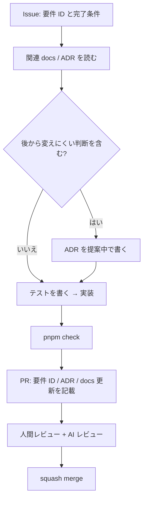

# AI 開発ハーネス

- ステータス: ドラフト
- 最終更新: 2026-10-07
- 関連: [ADR-0008](../adr/0008-ai-development-harness.md) / [開発ルール](./development-rules.md)

Claude Code などの AI エージェントが、少ない指示で正しく開発を進められるようにするための仕組みの一覧。何をどこに置くか、作業がどう流れるかを定める。

## 1. 情報の置き場所（段階的開示）

AI は毎回 `CLAUDE.md` を読み、必要に応じてリンク先を読む。上ほど常に読み込まれ、下ほど必要なときだけ読む。

| 層 | 置き場所 | 中身 | 更新頻度 |
|---|---|---|---|
| 入口 | `CLAUDE.md` | 一行説明、地図、コマンド、必須ルール、リンク | 低 |
| 他ツール | `AGENTS.md` | `CLAUDE.md` を参照させるだけ | ほぼなし |
| パッケージ | `packages/*/CLAUDE.md`（コード導入時） | そのパッケージ固有の注意点（例: format は再エンコード禁止） | 中 |
| 要件 | `docs/01-requirements/` | 何を作るか。要件 ID | 中 |
| 判断 | `docs/adr/` | なぜその方式か。何を捨てたか | 追記のみ |
| 設計 | `docs/03-design/` | 今の形 | 中 |
| 計画 | `docs/04-plan/` | 次に何をやるか | 高 |

**CLAUDE.md に書くもの・書かないもの**

- 書く: 毎回守ってほしいこと（検証コマンド、依存方向、PII の扱い、ADR との矛盾禁止）。
- 書かない: 詳細な仕様（リンクで済ませる）、すぐ古くなる情報（進捗など）、コードを読めばわかること。

## 2. 作業の流れ

- **Issue に完了条件を書く。** AI は完了条件をテストに落としてから実装する。
- **判断が必要になったら止まって ADR を書く。** 実装の途中で方式を勝手に変えない。
- **`pnpm check` が通らない PR は出さない。**

## 3. 検証の自動化

| 仕組み | 内容 | 導入時期 |
|---|---|---|
| `pnpm check` | lint + typecheck + test を 1 コマンドで | M0 |
| GitHub Actions | PR ごとに `pnpm check` | M0 |
| Claude Code フック（`.claude/settings.json`） | ファイル編集後に Biome format、停止前に変更パッケージのテスト | M0（コード導入時） |
| SessionStart フック | クラウド環境で依存をインストール | M0 |
| AI レビュー | PR に Claude のコードレビュー（要件 ID・ADR との矛盾も確認） | M0 以降 |

フックは「AI が忘れても機械的に守られる」ことに使う。判断が必要なものはフックにしない。

## 4. 繰り返し作業のスキル化（コード導入後に追加）

| スキル / コマンド案 | 用途 |
|---|---|
| `new-adr` | 次の番号でテンプレートから ADR を作成し、一覧に追記 |
| `format-change` | 形式仕様の変更手順（バージョン、マイグレーション、フィクスチャ、仕様書）をチェックリストで実行 |
| `add-annotation-type` | 注釈の種類を追加するときに触る場所（model / render / editor / MCP スキーマ / docs）を順に実行 |
| `ai-eval` | 評価用画像セットで提案・PII 検出を評価し、前回との差分を出す |

3 回以上同じ手順を繰り返したら、スキルにする。

## 5. 履歴の保持

| 何の履歴か | どこに残るか |
|---|---|
| 設計判断とその理由 | ADR（承認後は書き換えず、新しい ADR で置き換える） |
| 要件の変遷 | 要件定義の ID（削除せず「廃止」）+ Git 履歴 |
| ファイル形式の変遷 | 形式仕様のバージョン + マイグレーション + フィクスチャ |
| 実装の変遷 | Conventional Commits + PR（要件 ID・ADR を記載） |
| 議論の経緯 | PR / Issue のコメント。結論は ADR か docs に転記する |

チャットや会話の中だけで決まったことは、残らない。決まったら必ず ADR か docs に書く。

## 6. AI エージェントへの注意事項（CLAUDE.md の元ネタ）

- ベース画像を再エンコードしない（ADR-0004）。
- PII 加工を可逆な注釈として実装しない（ADR-0007）。
- 描画を環境ごとに分岐させない。描画は `packages/render` の 1 系統（ADR-0005）。
- テスト画像に実在の個人情報を使わない。
- 不明点・判断が必要な点は、推測で実装せず、ADR 提案または質問として残す。
